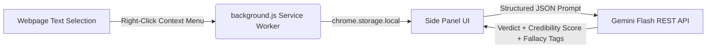

<div align="center">
  <h1>⚖️ PageArbiter</h1>
  <p><strong>Real-Time AI Claim Verifier, Credibility Scorer & Rhetorical Bias Auditor for Chrome</strong></p>
  <p>
    
    
    
    
  </p>
</div>

---

## 📌 Overview
**PageArbiter** is a lightweight, privacy-first Chrome Extension (Manifest V3) built for **Arbiter Hacks V1**. It turns Chrome's native Side Panel into an instant, impartial fact-checker and rhetorical framing auditor—letting users verify viral claims, statistics, and news excerpts without leaving the page they are reading.

## ✨ Key Features
- **🖱️ Right-Click Context Menu Audit:** Highlight any sentence or paragraph on any webpage -> right-click -> select **"Verify claim with PageArbiter"** to trigger an instant Side Panel audit.
- **📊 Factual Credibility Index (0–100%):** Generates a structured verdict (`TRUE`, `FALSE`, `MISLEADING`, `UNVERIFIED`) paired with a visual credibility meter.
- **🎭 Rhetorical Bias & Fallacy Detection:** Goes beyond binary fact-checking by flagging emotional framing, cherry-picked data, hyperbole, and logical fallacies with structured pill tags.
- **🔗 Verifiable Reference Citations:** Surfaces direct links to authoritative reference material so readers can inspect the underlying evidence themselves.
- **⚡ 1-Click Judge Presets & Copy Report:** Built-in preset test chips (*Test Myth*, *Test Bias*, *Test Fact*) for instant evaluation, plus 1-click Markdown report copying.

## 🏗️ System Architecture



## 🚀 Quick Installation (60 Seconds)
1. Clone or download this repository:
   ```bash
   git clone https://github.com/Swastik777YT/page-arbiter.git
   ```
2. Open Google Chrome and navigate to `chrome://extensions`.
3. Enable **Developer mode** in the top-right corner.
4. Click **Load unpacked** (top-left) and select the `page-arbiter` folder.
5. Click the **PageArbiter** icon in your Chrome toolbar, click **API Key**, and paste a free Gemini API key from [Google AI Studio](https://aistudio.google.com/apikey).

## 🛠️ Tech Stack
- **Frontend:** HTML5, Modern CSS3 (Custom Dark Charcoal & Sage Design System), Vanilla JavaScript (ES2024)
- **Browser APIs:** Chrome Extension Manifest V3 (`sidePanel`, `contextMenus`, `storage`, `activeTab`)
- **AI Engine:** Google Gemini Flash API (`responseMimeType: "application/json"` with multi-model resilience fallback)

## 📄 License
Distributed under the **MIT License**. See `LICENSE` for more information.
